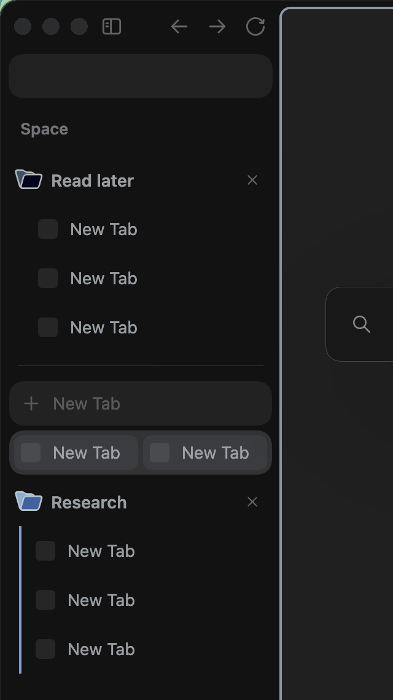

# Group Close Button

A [Sine](https://github.com/CosmoCreeper/Sine) mod for [Zen Browser](https://zen-browser.app) that puts a close button (×) on every tab group and folder header, so you can close a whole group in one click.

  
  

Before (left) and after (right).

## What changes

- Every tab group and folder header in the sidebar gets a × at its far right. It is always visible, dimmed at rest and full strength on hover.
- One click closes the group together with all of its tabs, with no confirmation. Changed your mind? Press Cmd+Shift+T (Ctrl+Shift+T on Windows and Linux) to reopen the closed group.
- Group and folder titles use the sidebar's normal text color instead of the group color, so they read like the rest of the sidebar.

## Install

1. Open Sine in Zen's settings.
2. Under "or, add your own locally from a GitHub repo", enter `rignaneseleo/zen-group-close-button` and install.
3. Until the mod is listed in the Sine store, turn on "Enable installing JS from unofficial sources" (`sine.allow-unsafe-js`), otherwise the mod's script does not run and the × never appears.
4. Restart Zen.

## Works with

- Zen 1.24 and later (verified on Zen 1.24b).
- Plain tab groups and native Zen folders.
- [Advanced Tab Groups](https://github.com/Vertex-Mods/Advanced-Tab-Groups), including its folder look. The mod hides ATG's own hover-only close button so you never see two.

The × is not shown on split-view groups, and it is hidden while the sidebar is collapsed.

## Notes

- Closing uses Zen's normal close path, so a page with an unsaved form may still ask before it closes.
- If you previously added your own close button to group headers with `userChrome.css` rules or by patching ATG's folder look, remove those rules so you do not end up with two buttons.

## Development

`./test/run.sh` runs an integration test on macOS in a throwaway profile (your real profile is never touched) and saves sidebar screenshots. See [test/README.md](test/README.md) for requirements and options.

## License

MIT, see [LICENSE](LICENSE).
